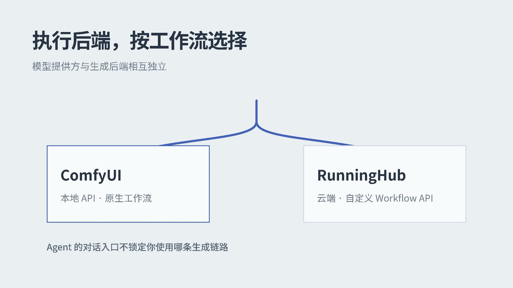

# AI 生图工坊（ai-image-studio）

面向**专业 AIGC 创作团队**的开源、本地优先 ComfyUI 创作工作台：保留 ComfyUI 节点工作流的自由度，同时提供自然语言操作、后台任务和统一结果查看，减少团队日常使用与维护工作流的摩擦。

> 项目重点：降低专业创作团队使用、复用和排查 ComfyUI 工作流的门槛，同时保留自有模型、节点与原生工作流的控制权。
>
> **产品目标：服务专业 AIGC 创作团队。** 当前运行模式为无需登录的单实例版本，不等同于已具备团队协作、多租户或企业级运维能力。

## 项目演示视频

[](showcase/ai-image-studio-explainer/renders/ai-image-studio-explainer.mp4)

点击封面播放 36 秒项目讲解视频。

## 技术栈

| 层    | 技术                                                 |
| ---- | -------------------------------------------------- |
| 后端   | FastAPI + SQLAlchemy 2 + Pydantic v2               |
| 任务队列 | Celery 5 + Redis（broker / result backend）          |
| 生成引擎 | 本地 ComfyUI（API 模式）+ 可选 RunningHub Workflow API |
| 存储   | SQLite（数据）+ 本地文件（图片）                               |
| 前端   | 原生 HTML / CSS / JS 单页（`frontend/index.html`，无构建步骤） |
| 访问模式 | 单实例匿名访问；模型与 RunningHub API Key 加密存储                    |

## 功能一览

1. **ComfyUI 自由操作**：打开原生节点和工作流界面；网页地址默认使用 `COMFYUI_WEB_URL`，也可按浏览器保存覆盖地址，并自检本地生成依赖。
2. **Agent 自动化**：始终由 MCP Agent 执行对话；生成后端可切换为本地 ComfyUI 或 RunningHub 自定义工作流，LLM 提供方与生成后端分别选择。本地后端可查询 ComfyUI 状态/工作流/队列并执行管理操作；有影响的本地操作需要用户确认。可选开启视觉质量 Harness，支持的生成结果会被审查，低于 8/10 时最多自动优化并重生成 2 次；RunningHub 重试会再次提交远程任务并可能产生费用。
3. **模型选择**：支持配置的 OpenAI 兼容服务、llama.cpp 和用户自定义 OpenAI 兼容模型；自定义 API Key 加密存储。
4. **创作助手能力**：可选启用项目文档 RAG、管理知识文档、编辑生成偏好；最近 20 条 Agent 对话历史保存在当前浏览器。
5. **创作结果库**：合并展示原任务 API 与 MCP Agent 生成的图片/视频，可点击预览；后端生图、视频和聊天 API 仍保留供外部集成使用。

本项目采用 MIT License。开源目标不是把 ComfyUI 封装成不可见的黑盒，而是在不限制团队自有模型、节点和工作流的基础上，提供更便捷的常用操作、可检查的执行过程和可贡献的扩展能力。当前部署和协作边界见[商业化市场调研与架构路线图](docs/商业化市场调研与架构路线图.md)。

## 本机环境（已确认）

- Python 3.13 虚拟环境：`backend/.venv`（依赖已安装）
- Redis：已在 `127.0.0.1:6379` 运行
- ComfyUI 0.43.0：已在 `127.0.0.1:8188` 运行，GPU 为 RTX 4060 Laptop（8GB）
- **模型情况（重要）**：本机没有传统 SD checkpoint，文生图走 Krea 2 组合加载，工作流 `workflows/Krea2-极清生图流+SeedVR2-int8图像放大.json` 已按本机模型配好：
  - 扩散模型：`Krea2-Moody-Mix-premium_int8_convrot.safetensors`（UNETLoader）
  - 文本编码器：`qwen3vl_4b_fp8_scaled.safetensors`（CLIPLoader，type=`krea2`）
  - VAE：`qwen_image_vae.safetensors`（VAELoader）
  - 出图流程：主采样（KSamplerAdvanced）→ 潜空间 1.5× 放大 → 二次精修采样（KSampler）

## 目录结构

```
ai-image-studio/
├── backend/
│   ├── app/
│   │   ├── main.py              # FastAPI 入口（/health、路由注册、建表）
│   │   ├── config.py            # 环境变量配置（含 LLM / 加密 / 额度）
│   │   ├── database.py          # SQLAlchemy 引擎/会话
│   │   ├── models.py            # User / Task / Image / Conversation / Message / UsageRecord ORM
│   │   ├── schemas.py           # Pydantic 请求/响应模型
│   │   ├── throttle.py          # 频率限流 + 每日 LLM 额度
│   │   ├── api/                 # generate / tasks / images / chat / conversations 路由
│   │   ├── services/
│   │   │   ├── comfy_client.py  # ComfyUI HTTP 客户端（提交/轮询/下载）
│   │   │   ├── llm_client.py    # 多 provider LLM 客户端（openai / llama / custom）
│   │   │   ├── mcp_agent.py     # MCP 工具发现与 Agent 循环
│   │   │   └── workflow.py      # 工作流模板加载 + {{参数}} 注入
│   │   └── workers/
│   │       ├── celery_app.py    # Celery 实例（含软/硬超时配置）
│   │       └── tasks.py         # 生成任务执行体（状态机 + 自动重试）
│   ├── tests/smoke_test.py      # 无需 ComfyUI/Redis 的端到端冒烟测试
│   ├── requirements.txt
│   ├── Dockerfile
│   └── ruff.toml
├── workflows/
│   └── Krea2-极清生图流+SeedVR2-int8图像放大.json   # 文生图工作流（ComfyUI API 格式）
├── frontend/
│   └── index.html               # 单文件前端（自定义操作 / Agent 自动化 / 结果库）
├── docs/                        # 架构、API、变更记录、商业化调研与版本路线图
├── docker-compose.yml
├── start_local.md               # 一键启动本地全链路
└── README.md
```

商业化方向、三项市场调研和建议版本闸门见 [`docs/商业化市场调研与架构路线图.md`](docs/商业化市场调研与架构路线图.md)。该文档中的目标架构和 V11+ 阶段是提案，不是当前已交付功能。

任务状态机：`pending → processing → completed / failed`（连接类失败自动重试 2 次）。

---

## 本地跑通全流程（Windows）

### 第 0 步：确认前置服务

Redis 与 ComfyUI 已在运行时可跳过。手动确认：

```powershell
# ComfyUI 健康检查，返回 JSON 即正常
Invoke-WebRequest http://127.0.0.1:8188/system_stats -UseBasicParsing

# Redis（若 6379 没监听，先启动 redis-server）
redis-server
```

### 第 1 步：激活虚拟环境（依赖已装好）

```powershell
cd D:\Study-Plan\ai-image-studio\backend
.\.venv\Scripts\Activate.ps1
```

> 如果以后要重装：  
> `py -3.13 -m venv .venv` → 激活 → `pip install -r requirements.txt`

### 第 2 步：先跑冒烟测试（不依赖 ComfyUI/Redis，验证代码链路）

```powershell
python tests\smoke_test.py

# 预期最后一行：SMOKE TEST PASSED（9/9）
```

### 第 3 步：启动 API 服务（终端窗口 A，保持开着）

```powershell
cd D:\Study-Plan\ai-image-studio\backend
.\.venv\Scripts\Activate.ps1
uvicorn app.main:app --reload --port 8000
```

看到 `Application startup complete.` 即成功。

### 第 4 步：启动 Celery worker（终端窗口 B，保持开着）

```powershell
cd D:\Study-Plan\ai-image-studio\backend
.\.venv\Scripts\Activate.ps1
celery -A app.workers.celery_app worker --loglevel=info --pool=solo
```

> **Windows 必须加 `--pool=solo`**（Celery 5 的 prefork 池在 Windows 不可用）。  
> 想要并发可改用 `--pool=threads --concurrency=2`；8GB 显存建议 solo 串行出图。  
> 看到 `celery@... ready.` 即成功。

### 第 5 步：打开前端

浏览器直接打开 `frontend/index.html`（前端硬编码后端地址 `http://127.0.0.1:8000`，需先启动 API）。无需注册或登录，打开后即可使用自定义操作和 Agent 自动化。

> 前端也可通过简单静态服务访问，例如在 `frontend/` 目录下 `python -m http.server 5500`。

### 第 6 步：提交生图任务（命令行方式）

```powershell
$body = @{
  prompt = "a cute corgi astronaut floating in space, digital art, highly detailed"
  negative_prompt = "blurry, low quality, watermark"
  aspect_ratio = "1:1 (Square)"
  megapixels = 1.0
  seed = -1
} | ConvertTo-Json
Invoke-RestMethod -Uri http://127.0.0.1:8000/api/generate -Method Post `
  -ContentType "application/json" -Body $body
```

> **首次出图较慢**：ComfyUI 要加载模型，首次执行耗时可能较长；之后出图时间取决于工作流和显卡。worker 窗口能实时看到进度。

### 第 7 步：查看结果

```powershell
# 任务详情（把 1 换成返回的任务 id），completed 后 images 里有 file_url
Invoke-RestMethod http://127.0.0.1:8000/api/tasks/1

# 图库列表
Invoke-RestMethod http://127.0.0.1:8000/api/images
```
图片文件同时保存在：

- 平台图库：`backend/data/images/<任务id>/`
- ComfyUI 原始输出：`D:\AI_MOVIE\ComfyUI_windows_portable\ComfyUI\output\`（前缀 Krea2）

---

## API 一览

所有接口均无需登录；API/Redis 仍仅绑定到本机回环地址。

| 方法     | 路径                                  | 说明                                |
| ------ | ----------------------------------- | --------------------------------- |
| GET    | `/health`                           | API 存活检查（不返回内部地址）                 |
| GET    | `/api/instance`                     | 获取浏览器可访问的 ComfyUI 网页地址          |
| GET    | `/api/instance/diagnostics`         | 检查本地数据库、Redis、Worker、ComfyUI、存储及默认 LLM 配置 |
| POST   | `/api/generate`                     | 提交文生图任务（返回 202 + task id）         |
| GET    | `/api/tasks?status=&limit=&offset=` | 任务列表（状态过滤 / 分页）                   |
| GET    | `/api/tasks/{id}`                   | 任务详情（含产物图片）                       |
| GET    | `/api/images`                       | 图库列表                              |
| GET    | `/api/images/{id}/file`             | 下载图片                              |
| POST   | `/api/chat`                         | LLM 对话（兼容 JSON 请求，支持多模态看图 + RAG） |
| POST   | `/api/chat/stream`                  | SSE 流式对话（openai / llama / custom）      |
| GET    | `/api/conversations/{provider}`     | 拉取指定 provider 对话历史                |
| DELETE | `/api/conversations/{provider}`     | 清空指定 provider 对话历史                |
| POST   | `/api/agent/generate`               | 一句话生图（多 Agent 流水线，返回任务 id）      |
| POST   | `/api/agent/mcp`                    | MCP Agent 直连 ComfyUI 自主控制（返回任务 id）   |
| GET    | `/api/agent/result/{task_id}`       | 查询 Agent 任务状态与结果                      |
| GET    | `/api/agent/files`                  | 列出 MCP Agent 生成的媒体                    |
| GET    | `/api/agent/files/{filename}`       | 读取 MCP Agent 生成的媒体文件用于预览           |
| GET    | `/api/runninghub/config`            | 读取 RunningHub 工作流配置（不含 API Key）       |
| PUT    | `/api/runninghub/config`            | 保存 RunningHub 配置（API Key 加密存储）          |
| POST   | `/api/runninghub/workflow-nodes`    | 发现工作流可映射的文本输入                      |
| GET    | `/api/agent/memory`                 | 查看个人助手保存的 ComfyUI 偏好                 |
| PATCH  | `/api/agent/memory`                 | 更新个人助手偏好                               |
| DELETE | `/api/agent/memory`                 | 清除个人助手全部偏好记忆                         |
| GET    | `/api/rag/docs`                     | 列出知识库文档（固定 + 动态）                |
| POST   | `/api/rag/docs`                     | 上传 md 加入知识库                       |
| DELETE | `/api/rag/docs/{filename}`          | 删除知识库动态文档                        |
| GET    | `/api/custom-models`                | 列出自定义模型配置（不含 key 明文）            |
| POST   | `/api/custom-models`                | 保存自定义模型配置（key 加密存储）              |
| DELETE | `/api/custom-models/{id}`           | 删除自定义模型配置                        |

Swagger：<http://127.0.0.1:8000/docs>

## 版本迭代（V）

- **V1**：ComfyUI 后端闭环（文生图、任务状态、图库下载）。
- **V2（历史版本，当前已移除）**：曾加入登录鉴权与账号数据隔离。
- **V3**：LLM 对话助手（OpenAI 兼容 / llama.cpp）+ 多模态看图 + RAG。
- **V4**：多 Agent 固定流水线（提示词优化 → 生图 → 审图）。
- **V5**：MCP Agent 直连 ComfyUI（查询状态/队列、生成、中断、清队列、释放显存）。
- **V6**：MCP Agent 对话控制 ComfyUI，显示工具执行进度，并预览生成图片/视频。
- **V7**：增强 ComfyUI 管理（查看工作流/节点/输入素材、按 ID 删除排队任务），中断、清队列、删除素材及释放显存前需在界面确认。
- **V8**：为个人助手增加可查看/编辑/清除的持久偏好记忆，并让 MCP Agent 在生成时使用这些默认偏好。
- **V9**：为通用聊天 API 增加 SSE 流式响应，同时保留 JSON 对话接口。
- **未发布**：前端拆分为“自定义操作 / Agent 自动化”；Agent 支持模型选择、历史上下文、可选 RAG 和对话式视频生成。
- **V11（开发中）**：Agent 可切换本地 ComfyUI 或 RunningHub；支持加密保存 API Key、发现并映射自定义工作流文本节点、下载远程输出到结果库。

### MCP Agent 使用方式

在“Agent 自动化”区选择模型并输入自然语言指令（例如“先看下状态，再画一只太空柯基”或“生成一段黄昏海边的短视频”）。在“自定义操作”区可直接打开 ComfyUI 网页。也可以直接调用 Agent API：

生成后端与 LLM 模型相互独立。在 Agent 区选择 **RunningHub** 后，先打开 **RunningHub 设置**，填写 API Key 和 Workflow ID，加载工作流文本输入并选择正向（以及可选的负向）提示词节点后保存。API Key 只会加密保存在服务端，读取配置时不会返回明文。

1. 提交自然语言指令：

```http
POST /api/agent/mcp
Content-Type: application/json

{
  "request": "先看下 ComfyUI 状态，然后生成一张太空柯基，最后告诉我图片路径"
}
```

2. 查询任务进度和最终结果：

```http
GET /api/agent/result/{task_id}
```

> 说明：MCP Server 进程由 Agent 任务内部自动拉起（stdio 传输），无需单独常驻守护。
> Agent 生成的图片/视频会在会话和结果库中预览；可选 OpenAI 兼容模型、llama.cpp 或已保存的自定义模型。
> V7 中断、清空队列、删除指定队列任务/输入素材、释放显存等有影响的操作会暂停并弹出确认框；确认状态最多等待 5 分钟。
> V8 点击 **个人记忆** 可设置偏好画风、模型预设、工作流、宽高比、分辨率、负向提示词和其他生成习惯。用户明确说“记住”时，Agent 也会通过工具保存；当前指令中的明确参数优先于已保存默认值。

## 开发与贡献

- [贡献指南](CONTRIBUTING.md)
- [MIT License](LICENSE)
- GitHub Actions CI 自动编译后端，并使用模拟 ComfyUI 测试 MCP Agent。

## 参数说明（Krea 2 工作流）

| 参数                | 说明                                             |
| ----------------- | ---------------------------------------------- |
| `prompt`          | 正向提示词（1–4000 字）                                |
| `negative_prompt` | 负向提示词（默认空，≤4000 字）                             |
| `aspect_ratio`    | 宽高比，作用于 ResolutionSelector 节点，8 档可选（见下）        |
| `megapixels`      | 目标百万像素（0.1–16.0），作用于 ResolutionSelector，默认 1.0 |
| `seed`            | 种子，`-1` 随机、固定数字可复现                             |

宽高比可选值：`1:1 (Square)` · `2:3 (Portrait Photo)` · `3:2 (Photo)` · `3:4 (Portrait Standard)` · `4:3 (Standard)` · `9:16 (Portrait Widescreen)` · `16:9 (Widescreen)` · `21:9 (Ultrawide)`

采样参数（steps / cfg / sampler / scheduler / denoise）已固化在工作流 JSON 中，不在 API 暴露。

Agent 通过后端 MCP 工具直接连接 `COMFYUI_BASE_URL`，不需要浏览器自动化。网页入口的地址只影响用户浏览器打开的目标，不会改变 Agent 的 API 连接地址。

## 环境变量（均有默认值，一般不用改）

| 变量                     | 默认值                                  | 说明                     |
| ---------------------- | ------------------------------------ | ---------------------- |
| `COMFYUI_BASE_URL`     | `http://127.0.0.1:8188`              | 后端/MCP 连接 ComfyUI API 的地址；Docker Compose 默认 `http://host.docker.internal:8188`，可通过 `.env` 覆盖 |
| `COMFYUI_WEB_URL`      | `http://127.0.0.1:8188`              | 浏览器打开 ComfyUI 的默认网页地址；远程访问时设置为浏览器可达地址，也可在页面按浏览器覆盖 |
| `DATABASE_URL`         | `sqlite:///backend/data/aistudio.db` | 数据库                    |
| `IMAGE_STORAGE_DIR`    | `data/images`                        | 图片存储目录                 |
| `REDIS_URL`            | `redis://127.0.0.1:6379/0`           | Celery broker          |
| `WORKFLOW_DIR`         | `../workflows`                       | 工作流模板目录                |
| `WORKFLOW_FILE`        | `Krea2-极清生图流+SeedVR2-int8图像放大.json`  | 工作流模板文件名               |
| `COMFY_TIMEOUT`        | `900`                                | 单次生成超时（秒）              |
| `COMFY_POLL_INTERVAL`  | `2.0`                                | ComfyUI 输出轮询间隔（秒）      |
| `OPENAI_BASE_URL`      | `https://api.openai.com/v1`          | OpenAI 兼容服务地址（Docker Compose 从根目录 `.env` 传给 API 和 Worker） |
| `OPENAI_API_KEY`       | (空)                                  | OpenAI 兼容服务密钥；只存于被忽略的本机 `.env`，不要提交或发到聊天中 |
| `OPENAI_MODEL`         | `gpt-4o-mini`                        | OpenAI 兼容模型名           |
| `LLAMA_BASE_URL`       | `http://127.0.0.1:8080/v1`           | 本地 llama.cpp server 地址 |
| `LLAMA_API_KEY`        | (空)                                  | llama.cpp server 密钥    |
| `LLAMA_MODEL`          | `llama-3.1-8b`                       | llama.cpp 模型名          |
| `LLAMA_MAX_TOKENS`     | `1024`                               | llama.cpp 最大生成 token   |
| `DEFAULT_LLM_PROVIDER` | `openai`                             | 默认 LLM provider        |
| `DAILY_CHAT_QUOTA`     | `100`                                | 每用户每日 LLM 额度（-1 不限）    |
| `CORS_ORIGINS`         | `*`                                  | CORS 允许来源（逗号分隔）        |

> 完整模板见 `.env.example`。生产环境务必覆盖 `ENCRYPTION_KEY` 与各 LLM API Key。

使用 OpenRouter 时，将 `OPENAI_BASE_URL` 设为 `https://openrouter.ai/api/v1`，`OPENAI_MODEL` 设为 OpenRouter 提供的模型 ID，并把新 API Key 放在本机 `.env` 中；Docker Compose 会将这些设置传给 API 和 Worker。也可在 Agent 区选择 OpenAI 兼容 provider。

## 常见问题

1. **worker 启动报 billiard/prefork 错误** → Windows 加 `--pool=solo`。
2. **任务一直 pending** → worker 没启动或没连上 Redis，看 worker 窗口日志。
3. **任务 failed：无法连接 ComfyUI** → 确认 ComfyUI 已启动且端口 8188。
4. **任务 failed：节点 / 模型错误** → 工作流与本机模型不匹配，看 worker 日志里 ComfyUI 返回的完整报错，检查工作流 JSON 中的模型文件名。
5. **对话返回「LLM 服务暂不可用」** → 未配置对应 provider 的 API Key，或 LLM 服务不可达；配好 Key 后即可调用真实模型（未配 Key 时返回占位回复，保证链路可先跑通）。
6. **端口被占用** → uvicorn 改 `--port 8001`，同时把前端 `index.html` 里的 `API` 常量一并改掉。


## Docker 部署（日常开发测试方式）

**架构**：ComfyUI 与 llama.cpp 运行在宿主机（GPU 直通），Redis / API / Worker 容器化。
API 和 Worker 共用 CPU-only 镜像，GPU 推理由宿主机上的 ComfyUI / llama.cpp 负责。Docker Compose 默认通过 `http://host.docker.internal:8188` 连接宿主机 ComfyUI。若 ComfyUI 在其他主机或端口，请在项目根目录 `.env` 中设置 `COMFYUI_BASE_URL`，API 和 Worker 会共用该地址。`COMFYUI_WEB_URL` 则是用户浏览器打开的默认网页地址，两者用途不同。

### 远程后端连接本机 ComfyUI（SSH 反向隧道）

当 API / Worker 部署在 Azure、ComfyUI 运行在本机时，保持 `COMFYUI_BASE_URL=http://host.docker.internal:8188`。Azure 上的 SSH 服务需为对应账号启用 `GatewayPorts clientspecified`（建议放在该账号的 `Match User` 配置中），然后在本机 PowerShell 启动并保持隧道：

```powershell
# 将 172.17.0.1 替换为服务器 Docker bridge gateway（可在服务器运行 docker network inspect bridge）
ssh -N -o ServerAliveInterval=30 -o ServerAliveCountMax=3 `
  -R 172.17.0.1:8188:127.0.0.1:8188 user@server
```

远端监听应绑定 Docker bridge gateway，而不是 `0.0.0.0`，避免把 ComfyUI API 暴露到公网。关闭 SSH 隧道后，API 和 Worker 将无法访问本机 ComfyUI。

```
宿主机（Windows）
  ├─ ComfyUI        :8188   ← 生图引擎，GPU 直通
  └─ llama-server   :8080   ← 本地 LLM，GPU 直通（阶段 1 接入）

Docker 容器
  ├─ aistudio-redis   :6379
  ├─ aistudio-api     :8000   ← FastAPI 后端
  └─ aistudio-worker          ← Celery 出图任务
```

### 启动后端（三个容器）

```powershell
cd D:\Study-Plan\ai-image-studio
docker compose up -d --build
```

- `docker compose ps` 查看容器状态（三个都应 `Up`）；
- `docker compose logs -f api` / `-f worker` 跟踪日志；
- API 代码已挂载热更新（`./backend/app:/app/app` + `--reload`），改后端代码无需重新 build；
- 改了 `docker-compose.yml` 本身，用 `docker compose up -d api`（或 `--force-recreate`）重建。
- API 和 Redis 的宿主机端口只绑定到 `127.0.0.1`，不会直接暴露到公网。远程服务器可用 SSH 本地转发访问 API：

  ```sh
  ssh -N -L 18000:127.0.0.1:8000 user@server
  ```

  然后在本机浏览器打开 `http://127.0.0.1:18000`。该单实例应用无需登录。首次部署前应在项目根目录创建 `.env`，并将 `ENCRYPTION_KEY` 替换为随机值；不要提交 `.env`。

### 启动宿主机服务（ComfyUI + llama）

**ComfyUI**（生图）：宿主机启动后监听 `127.0.0.1:8188`，Worker 容器经 `host.docker.internal:8188` 回调。

**llama.cpp 本地 LLM**（对话，阶段 1）：

```powershell
cd D:\llama\llama-b11105-bin-win-cuda-13.4-x64
.\llama-server.exe -m .\models\Qwen3-8B-Q4_K_M.gguf --host 0.0.0.0 --port 8080 --n-gpu-layers 45 --ctx-size 4096
```

> 关键：`--host 0.0.0.0`（让容器能访问）、`--n-gpu-layers 45`（GPU 加速）、`--ctx-size 4096`（省显存）。  
> 看到 `listening on http://0.0.0.0:8080` 即成功。**该窗口需保持开启**（前台进程，关窗口即停服务）。  
> 设置 `DEFAULT_LLM_PROVIDER=llama` 后，对话走本地 LLM；Docker Compose 默认值为 `openai`。模型 Qwen3-8B Q4_K_M 约 8 token/s。

### 国内拉镜像：配置加速器

国内直连 Docker Hub 会超时，需给 Docker Desktop 配镜像加速器（`registry-mirrors` 字段放在 daemon.json **顶层**）：

```json
{
  "registry-mirrors": [
    "https://docker.m.daocloud.io",
    "https://mirror.ccs.tencentyun.com",
    "https://hub-mirror.c.163.com"
  ]
}
```

配置后重启 Docker Desktop，`docker info | Select-String "Registry Mirrors"` 验证生效。

---

## 工作流 JSON 变更指引

工作流模板位于 `workflows/Krea2-极清生图流+SeedVR2-int8图像放大.json`，通过 `{{占位符}}` 注入参数。**变更工作流时遵循以下约定：**

1. **占位符必须与 `build_workflow()` 对齐**：目前支持 `{{prompt}}`、`{{negative_prompt}}`、`{{aspect_ratio}}`、`{{megapixels}}`、`{{seed}}` 五个占位符，注入逻辑在 `backend/app/services/workflow.py`。
2. **加了新占位符，必须同步三处**：
   - `workflow.py` 的 `build_workflow()` 里把参数加进 `params` 字典；
   - `schemas.py` 的 `GenerateRequest` 里加对应字段；
   - `api/generate.py` 里把字段写进 `GenerationTask`，且 `models.py` 加对应列（若需持久化）。
3. **改了文件名 / 目录**：更新 `.env` 的 `WORKFLOW_FILE`（或 config.py 默认值），无需改代码。
4. **模型文件名变了**（UNETLoader / CLIPLoader / VAELoader 里的 `.safetensors`）→ 直接改 JSON 对应节点的 `inputs`，但要确认本机确实有该模型文件，否则任务会 failed。
5. **改完必跑冒烟测试**：`python tests/smoke_test.py`，其中会校验 `{{prompt}}` / `{{negative_prompt}}` / `{{seed}}` / `{{aspect_ratio}}` / `{{megapixels}}` 是否正确注入。若新增了占位符，建议在冒烟测试里补一条对应断言。

> 提示：若在 ComfyUI 界面里可视化编辑工作流，导出 API 格式 JSON 时，把要动态变化的字段值手动改成 `{{占位符}}` 字符串即可，其余结构保持不变。

## 多用户资源调度说明

当前实现面向「单机单人 / 少量用户」，多用户并发出图时资源调度机制如下：

**现状（已具备）**

- **任务隔离**：每个任务归属 `user_id`，任务 / 图库查询均按用户过滤。
- **队列串行**：所有出图任务进入同一条 Celery 队列（`aistudio`），由 worker 按 FIFO 消费。
- **显存保护**：Windows 下建议 `--pool=solo` 串行出图，天然避免多任务同时抢占 8GB 显存导致 OOM。
- **LLM 侧已限流**：对话有每用户每分钟 20 次频率限制 + 每日额度（默认 100 次），但**生图接口目前没有限流 / 排队配额**。

**多用户压力下的风险与建议**

| 问题         | 表现              | 建议方案                                                                      |
| ---------- | --------------- | ------------------------------------------------------------------------- |
| 生图无配额      | 个别用户狂提交占满队列     | 仿照 `throttle.py` 给 `/api/generate` 加每日额度（`UsageRecord.image_count` 字段已预留） |
| 长队无感知      | 用户看不到排队位置       | 任务列表已支持 `pending` 状态，前端可展示排队序号 / 预计等待                                     |
| 公平性        | 无优先级，纯 FIFO     | 引入 Celery 优先级队列（`x-max-priority`）或按用户加权                                   |
| 显存并发       | 8GB 显存扛不住多任务并行  | 保持 solo 串行；若上多卡 / 大显存，改用 `--pool=threads` 并限制并发                           |
| 内存限流失效     | 多 worker 进程各自计数 | `throttle.py` 已注明：多进程部署需把限流迁到 Redis（Lua 脚本 / `INCR` + 过期）                 |
| SQLite 写竞争 | 高并发写库可能锁库       | 多用户规模上去后换 PostgreSQL，Celery 仍用 Redis                                      |

**若要支撑真正的多用户并发**，建议按优先级推进：① 生图加每日额度与限流；② 前端展示排队状态；③ 限流与额度计数迁到 Redis；④ 数据库换 PostgreSQL；⑤ 按需引入优先级队列与多 worker 水平扩展。
