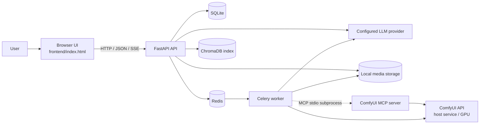

# Architecture

## 1. Product and system boundaries

AI Image Studio is a private, single-instance assistant for an individual
ComfyUI installation. Authentication protects the instance and its API; it
does not make the application a multi-tenant SaaS product. The backend
currently stores account-owned application data, while ComfyUI preferences are
instance-level.

The application coordinates existing services rather than implementing an
image or video inference engine:

- **AI Image Studio** provides the web UI, API, authentication, task
  orchestration, conversation features, and media catalog.
- **ComfyUI** executes API-format workflows and accesses the configured models
  and GPU.
- **Redis and Celery** dispatch and execute long-running generation and agent
  tasks.
- **LLM providers** supply chat completions and agent tool-selection decisions.
- **SQLite and local files** persist application records, knowledge-base data,
  and generated media.

## 2. System context



In the current Docker Compose setup, Redis, API, and worker are containers.
ComfyUI and an optional local `llama.cpp` server run outside the Compose stack;
the containers reach host services through their configured URLs. The browser
UI is a single HTML/CSS/JavaScript page served by FastAPI. It has no frontend
build step.

## 3. Runtime components and responsibilities

| Component | Responsibility | Main code |
|---|---|---|
| Web/API | Serve the UI, validate requests, authenticate users, expose REST and SSE endpoints | `backend/app/main.py`, `backend/app/api/` |
| Domain schemas and persistence | Request/response validation, SQLAlchemy entities, SQLite sessions | `backend/app/schemas.py`, `models.py`, `database.py` |
| ComfyUI integration | Submit workflows, inspect status/history/queue, retrieve generated media | `backend/app/services/comfy_client.py` |
| Workflow construction | Load image templates and build image/video workflows | `backend/app/services/workflow.py`, `video_workflow.py`, `workflows/` |
| Background execution | Execute generation and agent tasks; persist task state and media records | `backend/app/workers/` |
| LLM integration | Call configured OpenAI-compatible or local providers | `backend/app/services/llm_client.py` |
| MCP agent | Discover tools from the MCP server, expose them to the LLM, execute approved calls | `backend/app/services/mcp_agent.py`, `backend/app/mcp_server/` |
| Retrieval | Index fixed project documents and dynamic knowledge-base documents for RAG | `backend/app/services/rag.py` |
| Browser UI | Login, image/video generation, chat, task/gallery views, and agent interaction | `frontend/index.html` |

`backend/app/api/` owns HTTP concerns and delegates application work to
services or Celery tasks. The worker owns long-running generation and agent
execution. Workflow construction and ComfyUI communication are separate
services so they can be tested without running a GPU-backed ComfyUI instance.

## 4. Important request and execution flows

### 4.1 Image and video generation

```mermaid
sequenceDiagram
    participant U as Browser
    participant A as FastAPI
    participant D as SQLite
    participant R as Redis
    participant W as Celery worker
    participant C as ComfyUI
    U->>A: POST /api/generate or /api/generate-video
    A->>D: Create pending task
    A->>R: Enqueue Celery task
    A-->>U: 202 + task_id
    R->>W: Deliver task
    W->>D: Set processing
    W->>W: Build image/video workflow
    W->>C: Submit workflow
    C-->>W: prompt_id and completion/media
    W->>W: Download and save output files
    W->>D: Save media metadata; mark completed/failed
    U->>A: Poll task/gallery endpoints
    A-->>U: Task status and authenticated media URLs
```

The API responds after task submission; it does not wait for inference. The
worker updates the task through `pending`, `processing`, and a terminal
`completed` or `failed` state. Transient ComfyUI connection/workflow errors can
be retried by the Celery task. Generated bytes are stored on local storage;
SQLite stores task and media metadata.

### 4.2 MCP Agent control

1. The authenticated client submits a natural-language request to
   `POST /api/agent/mcp`.
2. The API queues a Celery task and returns a task identifier.
3. The worker starts `python -m app.mcp_server` over MCP stdio, discovers its
   tools, and presents those tool schemas to the configured LLM.
4. The LLM selects a tool; the agent invokes it through MCP and returns its
   result to the LLM for the next decision or final response.
5. Tools that require user confirmation pause the task until the client
   confirms or rejects the pending action. A rejected or expired confirmation
   must not execute that action.
6. The task result includes the final answer and tool-call steps; generated
   files can be previewed through the agent file endpoint.

The agent is bounded by a maximum tool-call step count. Tool errors are
returned to the agent loop as errors; the assistant must not report a
successful action unless the tool result confirms it.

### 4.3 Chat, streaming, and retrieval

- `POST /api/chat` returns a JSON response; `POST /api/chat/stream` returns
  server-sent events.
- Both interfaces use the configured provider and can accept image input.
- When RAG is enabled, the retriever uses the current question and indexed
  documents to provide context. Per the current API behavior, chat history and
  image input are not included in the RAG prompt.
- Conversation persistence depends on the selected provider/configuration as
  described in `API接口文档.md`; do not assume every provider stores history.
- RAG indexes fixed project knowledge and user-managed dynamic documents. The
  vector index is a retrieval aid, not the source of truth for application
  records.

## 5. Data and storage boundaries

| Data | Current storage | Notes |
|---|---|---|
| User, task, image metadata, conversations, and usage records | SQLite | Shared application database; schema/entities are in `backend/app/models.py`. |
| Generated image/video bytes | Local filesystem | The database stores metadata and relative file paths; API endpoints enforce access checks when serving files. |
| Uploaded reference media | Configured ComfyUI input directory | The upload API returns the filename used by workflows. |
| Dynamic RAG documents and index | Configured local data directories | Persisted according to the deployment's volume/configuration. |
| ComfyUI models and workflow execution state | ComfyUI-managed storage | AI Image Studio submits workflows and does not own model-weight storage. |
| MCP agent preferences | SQLite-backed, instance-level preference record | This is distinct from account-scoped chat/task data. |
| Credentials and service URLs | Environment configuration | Keep secrets out of source control and logs. |

The Compose file mounts the application's `/data` directory for persistence.
Backups must account for both database contents and referenced media/document
files; copying only the SQLite database does not back up generated media.

## 6. API and error boundaries

- The browser communicates with FastAPI; it does not call ComfyUI or LLM
  providers directly.
- FastAPI request schemas validate public input. Services translate validated
  requests into provider-specific calls.
- Celery task IDs and ComfyUI `prompt_id` values are different identifiers:
  the former tracks application work; the latter tracks work inside ComfyUI.
- API authentication/ownership checks apply to protected endpoints. The
  standalone MCP server is a local stdio integration and is not an HTTP API.
- Upstream failures should be surfaced as task or API errors, not represented
  as successful output. Streaming errors use the SSE error event after a
  response has begun.
- The API reference and exact request/response shapes are maintained in
  `API接口文档.md`.

## 7. Engineering workflow

Use the following change lifecycle for code and documentation:

1. **Define scope:** identify the affected API, service, worker, UI, storage,
   and operational behavior. Keep the change compatible with the personal
   single-instance product scope unless a scope change is explicitly approved.
2. **Implement at the owning boundary:** keep HTTP validation in API/schema
   modules, external-service calls in services, and long-running work in
   Celery tasks. Reuse workflow and ComfyUI clients instead of duplicating
   execution logic.
3. **Test deterministically:** add or update focused tests. Mock ComfyUI,
   Redis, and LLM dependencies when the behavior under test does not require
   the real service; do not make ordinary CI depend on a GPU or model weights.
4. **Update documentation:** record user-visible changes in this file's
   `Unreleased` section; update `API接口文档.md` when contracts change and this
   architecture document when component boundaries or flows change. Update
   `README.md` for user-facing setup or feature changes.
5. **Validate locally and in CI:** run the checks in `CONTRIBUTING.md`; review
   the diff for generated files, secrets, and unrelated changes. A pull request
   is ready to merge only after required CI checks pass and review feedback is
   resolved.
6. **Release deliberately:** merge the release changes to `main`, move the
   applicable `Unreleased` entries to the versioned heading, then create and
   push a matching Git tag on the merged commit. Do not tag an open pull
   request.

The CI workflow is defined in `.github/workflows/ci.yml`. It currently compiles
the backend, imports key API routes, runs Ruff on the listed backend areas,
and runs the MCP Agent, preference-memory, and streamed-chat tests.

## 8. Operational constraints and non-goals

- ComfyUI and local LLM inference may compete for GPU memory. Resource
  scheduling and model unloading are explicit operations, not automatic
  multi-GPU orchestration.
- SQLite and local files are suitable for the current personal deployment;
  they are not a claim of horizontally scalable or multi-tenant storage.
- Public exposure, multi-user tenancy, cloud media storage, automated content
  moderation, and AI-content labeling are not currently implemented
  requirements. Evaluate security, privacy, and applicable regulations before
  exposing an instance beyond its trusted network.
- The Vue/Vite migration and broader multi-client deployment are optional
  roadmap items, not current runtime components.

## 9. Related documentation

- [API interface reference](API接口文档.md)
- [Technology evolution roadmap](项目技术演进路线图.md)
- [End-to-end flow explanation](全流程原理讲解.html)
- [Contribution guide](../CONTRIBUTING.md)
- [Change history](CHANGES.md)
