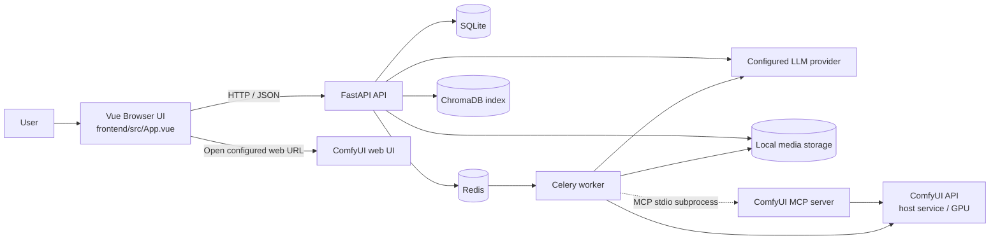

# Architecture

## 1. Product and system boundaries

AI Image Studio is an open-source, local-first creative workbench targeting
professional AIGC teams using ComfyUI. The current implementation is a
private, single-instance assistant: authentication protects the instance and
its API, but does not provide team collaboration or multi-tenant SaaS. The
backend currently stores account-owned application data, while ComfyUI
preferences are instance-level.

The application coordinates existing services rather than implementing an
image or video inference engine:

- **AI Image Studio** provides the web UI, API, authentication, task
  orchestration, conversation features, and media catalog.
- **ComfyUI** executes API-format workflows and accesses the configured models
  and GPU.
- **Redis and Celery** dispatch and execute long-running generation and agent
  tasks.
- **LLM providers** supply chat completions and agent tool-selection decisions.
- **SQLite and local files** persist application records, knowledge-base data,
  and generated media.

## 2. System context



In the current Docker Compose setup, Redis, API, and worker are containers.
ComfyUI and an optional local `llama.cpp` server run outside the Compose stack;
the containers reach host services through their configured URLs. The browser
UI is a Vue single-page application written in TypeScript and built by Vite; Docker packages the
production bundle into the API image, and FastAPI serves it from `/`.

## 3. Runtime components and responsibilities

| Component | Responsibility | Main code |
|---|---|---|
| Web/API | Serve the UI, validate requests, authenticate users, expose REST and SSE endpoints | `backend/app/main.py`, `backend/app/api/` |
| Domain schemas and persistence | Request/response validation, SQLAlchemy entities, SQLite sessions | `backend/app/schemas.py`, `models.py`, `database.py` |
| ComfyUI integration | Submit workflows, inspect status/history/queue, retrieve generated media | `backend/app/services/comfy_client.py` |
| Workflow construction | Load image templates and build image/video workflows | `backend/app/services/workflow.py`, `video_workflow.py`, `workflows/` |
| Background execution | Execute generation and agent tasks; persist task state and media records | `backend/app/workers/` |
| LLM integration | Call configured OpenAI-compatible or local providers | `backend/app/services/llm_client.py` |
| MCP agent | Discover tools from the MCP server, expose them to the LLM, execute approved calls | `backend/app/services/mcp_agent.py`, `backend/app/mcp_server/` |
| Quality review | Review generated images/video frames and run bounded prompt-refinement retries | `backend/app/services/quality_review.py`, `backend/app/services/mcp_agent.py` |
| Retrieval | Index fixed project documents and dynamic knowledge-base documents for RAG | `backend/app/services/rag.py` |
| Browser UI | Open ComfyUI for manual work, agent automation, and the result gallery | `frontend/src/App.vue` |

`backend/app/api/` owns HTTP concerns and delegates application work to
services or Celery tasks. The worker owns long-running generation and agent
execution. Workflow construction and ComfyUI communication are separate
services so they can be tested without running a GPU-backed ComfyUI instance.

## 4. Important request and execution flows

### 4.1 Image and video generation

```mermaid
sequenceDiagram
    participant U as Browser
    participant A as FastAPI
    participant D as SQLite
    participant R as Redis
    participant W as Celery worker
    participant C as ComfyUI
    U->>A: POST /api/generate or /api/generate-video
    A->>D: Create pending task
    A->>R: Enqueue Celery task
    A-->>U: 202 + task_id
    R->>W: Deliver task
    W->>D: Set processing
    W->>W: Build image/video workflow
    W->>C: Submit workflow
    C-->>W: prompt_id and completion/media
    W->>W: Download and save output files
    W->>D: Save media metadata; mark completed/failed
    U->>A: Poll task/gallery endpoints
    A-->>U: Task status and authenticated media URLs
```

The API responds after task submission; it does not wait for inference. The
worker updates the task through `pending`, `processing`, and a terminal
`completed` or `failed` state. Transient ComfyUI connection/workflow errors can
be retried by the Celery task. Generated bytes are stored on local storage;
SQLite stores task and media metadata.

### 4.2 MCP Agent control

1. The anonymous single-instance client submits a natural-language request to
   `POST /api/agent/mcp`.
2. The API queues a Celery task and returns a task identifier.
3. The worker starts the selected MCP server over stdio: `app.mcp_server` for
   local ComfyUI or `app.mcp_server.runninghub` for the configured RunningHub
   workflow. It discovers that server's tools and presents their schemas to
   the configured LLM.
4. The LLM selects a tool; the agent invokes it through MCP and returns its
   result to the LLM for the next decision or final response.
5. Tools that require user confirmation pause the task until the client
   confirms or rejects the pending action. A rejected or expired confirmation
   must not execute that action.
6. The task result includes the final answer and tool-call steps; generated
   files can be previewed through the agent file endpoint.

The agent is bounded by a maximum tool-call step count. Tool errors are
returned to the agent loop as errors; the assistant must not report a
successful action unless the tool result confirms it.

When `quality_review_enabled` is true, successful built-in image/video
generation is followed by a visual review using the selected LLM configuration.
Images are reviewed directly; videos are sampled at up to five evenly spaced
timestamps using the bundled `imageio-ffmpeg` executable. Scores of 8/10 or
higher pass; lower scores trigger an evaluator-provided prompt revision and at
most two additional generations. RunningHub retries submit another remote task
and may incur additional charges. Review errors and exhausted retries are
returned explicitly and are never represented as a passing result. The option
defaults to false, preserving the existing single-generation flow. Arbitrary
ComfyUI workflow JSON is not rewritten or automatically retried.

### 4.3 Automatic episode video

1. The client uploads a selected series root folder. Each episode subfolder
   contains exactly one storyboard (`.xlsx` or `storyboard.json`) and optional
   image, video, and audio assets.
2. The API validates relative paths, file and episode counts, total size,
   media types, and per-file limits; it stages each episode independently,
   copies supported assets into ComfyUI's input folder, and stores the series,
   episode ordering, and shot records in SQLite.
3. The selected LLM receives each storyboard's text and asset filenames, not
   media contents, and suggests asset IDs for each shot. The client can review
   all episodes and edit every suggestion and generation setting before
   starting production.
4. A Celery worker processes episodes in natural folder-name order, then
   processes each episode's shots and continuation segments sequentially
   through the existing ComfyUI video workflow. It persists completed
   segments; a failure stops later episodes, and resume continues at the
   failed episode without regenerating completed episodes or shots.
5. After an episode's shots complete, the worker uses the bundled FFmpeg
   executable to normalize dimensions, frame rate, and audio, then concatenates
   the clips into an MP4. Cancellation is checked during generation and
   assembly and stops the series queue.

The series workflow is a single-instance local-storage feature; its records
are not a multi-tenant project or shared team workspace. The single-episode
ZIP endpoints remain available for API compatibility.

### 4.4 Chat, streaming, and retrieval

- `POST /api/chat` returns a JSON response; `POST /api/chat/stream` returns
  server-sent events.
- Both interfaces use the configured provider and can accept image input.
- When RAG is enabled, the retriever uses the current question and indexed
  documents to provide context. Per the current API behavior, chat history and
  image input are not included in the RAG prompt.
- Conversation persistence depends on the selected provider/configuration as
  described in `API接口文档.md`; do not assume every provider stores history.
- RAG indexes fixed project knowledge and user-managed dynamic documents. The
  vector index is a retrieval aid, not the source of truth for application
  records.

### 4.5 Browser interaction model

- **Custom operation** opens the ComfyUI web interface at `COMFYUI_WEB_URL` by
  default. The user can save a browser-local override in the UI; it is scoped
  to the local single-instance profile and does not change server configuration. The
  browser-facing URL is separate from `COMFYUI_BASE_URL`, which the backend
  and MCP tools use for API calls.
- **Agent automation** submits every prompt to the MCP Agent. The selected
  built-in or custom LLM provider, recent conversation history, and optional
  RAG setting are included in the request; generation backend selection is
  independent of the LLM provider. The worker runs either local ComfyUI tools
  or the configured RunningHub workflow tool. The Agent does not need browser
  automation for ComfyUI control; opening the web UI is a user-clicked link.
- The Agent gallery combines the existing task-based media API with files
  produced by MCP tools. Recent Agent conversation history is stored in the
  browser's `localStorage`; legacy chat endpoints and direct generation APIs
  remain available to API clients, but their forms are not duplicated in the
  current UI.

## 5. Data and storage boundaries

| Data | Current storage | Notes |
|---|---|---|
| User, task, image metadata, legacy chat conversations, and usage records | SQLite | Shared application database; schema/entities are in `backend/app/models.py`. |
| Recent MCP Agent conversation | Browser `localStorage` | Stored in the browser; it is not synchronized to the backend. |
| RunningHub API key and workflow mapping | SQLite | New API keys use versioned authenticated encryption; configuration responses omit the key. |
| Generated image/video bytes | Local filesystem | The database stores metadata and relative file paths; API endpoints enforce access checks when serving files. |
| Uploaded reference media | Configured ComfyUI input directory | The upload API returns the filename used by workflows. |
| Dynamic RAG documents and index | Configured local data directories | Persisted according to the deployment's volume/configuration. |
| ComfyUI models and workflow execution state | ComfyUI-managed storage | AI Image Studio submits workflows and does not own model-weight storage. |
| MCP agent preferences | SQLite-backed, instance-level preference record | This is distinct from account-scoped chat/task data. |
| Credentials and service URLs | Environment configuration | Keep secrets out of source control and logs. |

The Compose file mounts the application's `/data` directory for persistence.
`scripts/backup_data.py` archives the complete directory and restores it while
preserving the pre-restore directory. Stop the API and Worker before either
operation so SQLite and media remain consistent. The archive excludes `.env`,
the Redis queue, ComfyUI models, and any external `COMFYUI_INPUT_DIR`; wait for
generation work to finish and the current queue to be empty before backup or
restore. Retain the encryption key separately because stored provider
credentials cannot be decrypted without it.

New credential ciphertexts use versioned Fernet authenticated encryption.
`ENCRYPTION_KEY` must be a high-entropy random value; `LEGACY_ENCRYPTION_KEY`
allows decrypting credentials written with a previous key or cipher. The
`app.cli.rotate_secrets` command atomically re-encrypts all stored provider keys
with the active key before the legacy key is removed.

## 6. API and error boundaries

- The browser communicates with FastAPI; it does not call ComfyUI or LLM
  providers directly.
- FastAPI request schemas validate public input. Services translate validated
  requests into provider-specific calls.
- Celery task IDs and ComfyUI `prompt_id` values are different identifiers:
  the former tracks application work; the latter tracks work inside ComfyUI.
- API authentication/ownership checks apply to protected endpoints. The
  standalone MCP server is a local stdio integration and is not an HTTP API.
- Upstream failures should be surfaced as task or API errors, not represented
  as successful output. Streaming errors use the SSE error event after a
  response has begun.
- The API reference and exact request/response shapes are maintained in
  `API接口文档.md`.

## 7. Engineering workflow

Use the following change lifecycle for code and documentation:

1. **Define scope:** identify the affected API, service, worker, UI, storage,
   and operational behavior. Keep the change compatible with the personal
   single-instance product scope unless a scope change is explicitly approved.
2. **Implement at the owning boundary:** keep HTTP validation in API/schema
   modules, external-service calls in services, and long-running work in
   Celery tasks. Reuse workflow and ComfyUI clients instead of duplicating
   execution logic.
3. **Test deterministically:** add or update focused tests. Mock ComfyUI,
   Redis, and LLM dependencies when the behavior under test does not require
   the real service; do not make ordinary CI depend on a GPU or model weights.
4. **Update documentation:** record user-visible changes in this file's
   `Unreleased` section; update `API接口文档.md` when contracts change and this
   architecture document when component boundaries or flows change. Update
   `README.md` for user-facing setup or feature changes.
5. **Validate locally and in CI:** run the checks in `CONTRIBUTING.md`; review
   the diff for generated files, secrets, and unrelated changes. A pull request
   is ready to merge only after required CI checks pass and review feedback is
   resolved.
6. **Release deliberately:** merge the release changes to `main`, move the
   applicable `Unreleased` entries to the versioned heading, then create and
   push a matching Git tag on the merged commit. Do not tag an open pull
   request.

The CI workflow is defined in `.github/workflows/ci.yml`. It currently compiles
the backend, imports key API routes, runs Ruff on the listed backend areas,
and runs the MCP Agent, preference-memory, streamed-chat, and quality-review
Harness tests.

## 8. Operational constraints and non-goals

- ComfyUI and local LLM inference may compete for GPU memory. Resource
  scheduling and model unloading are explicit operations, not automatic
  multi-GPU orchestration.
- SQLite and local files are suitable for the current personal deployment;
  they are not a claim of horizontally scalable or multi-tenant storage.
- Public exposure, multi-user tenancy, cloud media storage, automated content
  moderation, and AI-content labeling are not currently implemented
  requirements. Evaluate security, privacy, and applicable regulations before
  exposing an instance beyond its trusted network.
- Broader multi-client deployment and migration to a shared component library are optional
  roadmap items, not current runtime components.

## 9. Commercialization target (proposed, not implemented)

The target users are professional AIGC creation teams: artists, technical
artists, workflow authors, and production operators who need ComfyUI's control
and extensibility but want less friction in routine operations. Keep direct
access to native workflows and custom nodes; convenience features should
accelerate expert work, not hide or constrain it.

The MIT-licensed open-source value is inspectable execution, local control,
portable ComfyUI workflows, vendor-neutral model/provider adapters, and a
welcoming contribution path for workflow tooling and integrations. Keep the
backend a modular monolith while validating demand. The near-term boundaries
should make generation tasks, versioned workflows, projects, media assets,
execution backends, and usage records independently testable. Local
SQLite/files remain appropriate for the current single-instance edition.
PostgreSQL, object storage, team RBAC, billing, and managed GPU workers belong
to later phases, and only after professional teams validate those needs.

The proposed product phases, market evidence, architecture target, and go/no-go
gates are documented in
[Commercialization research and architecture roadmap](商业化市场调研与架构路线图.md).
These are recommendations, not completed product capabilities.

## 10. Related documentation

- [API interface reference](API接口文档.md)
- [Technology evolution roadmap](项目技术演进路线图.md)
- [Commercialization research and architecture roadmap](商业化市场调研与架构路线图.md)
- [End-to-end flow explanation](全流程原理讲解.html)
- [Contribution guide](../CONTRIBUTING.md)
- [Change history](CHANGES.md)
