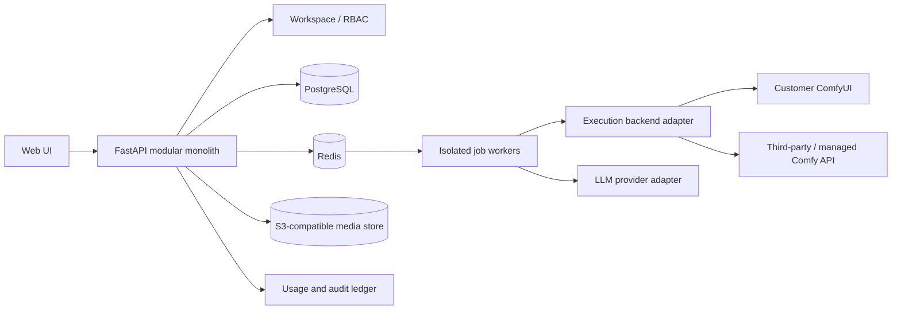

# 商业化市场调研与产品架构路线图

调研日期：2026-11-02 
状态：专业 AIGC 团队定位和本地优先方向已确认；V11 开始实施 
范围：AI 创作工具、ComfyUI 云工作流产品及专业创作团队的生产需求。公开资料用于形成假设，不替代客户访谈或法律意见。

## 结论摘要

项目的目标用户是**专业 AIGC 创作团队**，包括创作者、技术美术、工作流作者和生产运营人员。当前已有 FastAPI、Celery/Redis、ComfyUI MCP、图片/视频生成、RAG 和本地媒体库，但代码仍是**单实例工具**，还不是可以承诺企业级服务等级、多人隔离或按用量收费的商业产品。商业价值不在于再做一个“聊天框调用生图”，而在于减少专业团队配置、执行、复现和交接 ComfyUI 工作流的摩擦，同时保留专家需要的节点级控制。

**首个目标客户**：已经把 ComfyUI 用于实际制作、拥有自有工作流/模型/节点的专业创作团队。首期采用本地优先，让团队继续使用自己的 GPU、模型和 ComfyUI 环境；不先建设自营 GPU 云、多租户 SaaS 或另一个封闭式设计软件。具体客户规模和制作场景由专业团队访谈确定，不预先把电商或营销设为唯一赛道。

## 三项市场调研

### 调研一：通用 AI 创作产品的竞争边界

**观察**

- 主流产品把价值放在完整创作流程，而非单次生成：Adobe Firefly 将图像、视频和音频生成接入已有创意应用；Canva 将生成能力放进模板、品牌和营销设计流程；Midjourney 以订阅、生成额度和创作者控制项提供独立创作产品。
- 商业用户不仅需要“能生成”，还要关心许可规则、输入素材权利、隐私、品牌一致性、编辑能力和可重复交付。Adobe 公开的生成式 AI 使用指引同时强调第三方权利、安全政策、人工判断及内容凭证。
- 因此，本项目不应与这些产品争夺通用提示词生图或替代成熟图像编辑器。可利用的差异是 ComfyUI 的可组合工作流、用户自有模型/节点，以及本地执行选择；应把这些底层能力包装成简单而具体的任务入口。

**对本项目的含义**

1. Agent 是便捷入口，不是要替代 ComfyUI 的专家工作流编辑。应同时提供常用操作的简化入口和回到原生图节点的直达路径。
2. 专业团队的差异化需求包括工作流/自定义节点复用、依赖和模型兼容检查、队列执行、失败诊断、结果复现及团队间交接；需要通过目标团队访谈确认优先级。
3. 每个结果应能回溯输入、提示词、工作流版本、模型/LoRA、参数、种子、执行状态和人工审核结果。
4. 不应承诺“生成内容一定可商用”或提供版权保证。产品应展示模型/工作流许可来源，并要求用户确认上传素材和使用权；需要发布到商业环境时再咨询法律专业人士。

**来源**

- Adobe, *Inaugural Adobe Creators’ Toolkit Report*, 2025-10-28：调查 8 个国家/地区的 16,000 多位创作者；报告中 86% 使用创意生成式 AI，69% 担忧作品未经许可用于训练，成本、质量和训练透明度是采用障碍。样本偏向经常发布内容的 Gen Z / Millennial 创作者，不能直接代表所有专业工作室。
  https://news.adobe.com/news/2025/10/adobe-max-2025-creators-survey
- Adobe, *Generative AI User Guidelines*, 最近更新 2026-05-15：规定第三方权利、安全使用、人工判断和内容凭证等事项。
  https://www.adobe.com/legal/licenses-terms/adobe-gen-ai-user-guidelines.html
- Adobe Firefly 计划页（功能/额度/计划以官方页面实时说明为准）：
  https://www.adobe.com/products/firefly/plans.html
- Midjourney 官方计划与服务条款：
  https://docs.midjourney.com/hc/en-us/sections/28005319720845-Plan-Information
  https://docs.midjourney.com/hc/en-us/articles/32083055291277-Terms-of-Service
- Canva, *State of Marketing & AI* 报告入口；Canva 自有报告，仅作为营销团队需求线索，不将其厂商调研视作独立市场验证：
  https://www.canva.com/newsroom/news/marketing-ai-report/

### 调研二：ComfyUI 云与工作流托管产品

| 产品 | 公开产品主张 | 商业模式/重要能力 | 对本项目的启示 |
|---|---|---|---|
| Comfy Cloud / Comfy API | 官方托管 ComfyUI、模型和节点；工作流运行与 API 部署 | 订阅额度加 GPU 秒级/使用量计费；标准计划公开为年付折算约 US$16/月、月付 US$20/月；提供并发 Agent、部署和工作流时长限制 | 基础云运行、模型库和 Agent 已由上游进入，单做“ComfyUI 网页托管”缺乏差异 |
| RunComfy | 上传 workflow JSON，自动处理节点/模型/环境；原生 ComfyUI；模板和可复现运行环境 | 按需 GPU、工作流环境和 serverless API；其官网自述 200+ 模板、1M+ 创作者，属于厂商自报数据 | 环境配置、依赖错误、模板到可运行流程，是明确的产品价值点 |
| ThinkDiffusion | 免配置的 GPU 工作区、模型与扩展自由度、持久工作区 | 按 GPU 时长收费；官网列出 16/24/48GB 机器标准价约 US$0.99/1.75/2.50 每小时，并提供会员/团队方案 | GPU 托管资本和运维成本高，不应在缺乏需求验证前自建同类云 |

**对本项目的含义**

- 先作为 ComfyUI 上层的工作流产品，不与云厂商争 GPU 基建。支持本地 ComfyUI，逐步抽象 `ExecutionBackend`，未来可接用户自有服务器或第三方服务。
- 产品核心资产应是“经过验证的任务模板 + 环境/模型依赖说明 + 参数界面 + 运行追踪 + 可复用结果”，而不是自行复制整个 ComfyUI 编辑器。
- 若以后提供托管推理，采用按 GPU 时间/任务成本计量，明确队列、并发、存储和失败退款规则；先以第三方执行适配器验证单位经济，再考虑自建硬件。

**来源**

- Comfy Cloud 官方定价及额度说明（页面随时更新；本次访问显示 Standard 月付 US$20、年付折算 US$16/月，GPU 按活动秒数计费，另有 API 部署和并发限制）：
  https://comfy.org/pricing
- RunComfy 官方产品页（工作流依赖自动配置、模板、持久环境、团队分享及 serverless API 为厂商自述）：
  https://www.runcomfy.com/
- ThinkDiffusion 官方 GPU 价格/计划页：
  https://www.thinkdiffusion.com/pricing
- Comfy 官方 API 开发平台：
  https://comfy.org/platform/comfy-api

### 调研三：创作团队的采购条件与调研适用性

**观察**

- Adobe 的 2025 创作者调研显示，生成式 AI 已进入编辑/增强、生成新素材和创意构思；成本、输出稳定性、训练数据透明度和人工控制仍影响采用。
- Canva 的营销调研聚焦营销团队 AI 预算、工作流集成和结果衡量，可作为相邻市场信号。上述公开调研并非针对专业 AIGC 制作团队，不能证明其具体采购痛点、预算或转化率。
- 对专业团队而言，产品价值需要落在其现有制作管线：快速加载和复用复杂工作流、减少环境漂移、运行队列可观察、结果可复现，以及团队成员可以在不丢失专家控制权的前提下完成操作。

**对本项目的含义**

后续市场验证应直接访谈专业创作团队中的创作者、技术美术、工作流作者和制作负责人，观察其真实 ComfyUI 项目，重点测量环境/节点配置时间、工作流复用率、失败排查时间、返工次数、可复现率和交付周期。每个流程必须保留人工预览/批准点；不要将 Agent 自主操作当成无需审核的卖点。

公开调研不足以确认专业团队是否愿意为此付费。开发收费系统前应完成至少 10 次专业团队访谈和 3 个真实工作流试点，记录现有替代方案、当前成本、周任务量、部署限制、最希望贡献/扩展的能力及实际付款意愿。达不到验证门槛时，应调整产品问题，不以继续扩张技术栈代替需求验证。

**来源**

- Adobe Creators’ Toolkit Report（样本定义及调查方法见来源页）：
  https://news.adobe.com/news/2025/10/adobe-max-2025-creators-survey
- Canva, *State of Marketing & AI*（厂商发布的营销团队调查；报告入口及范围见来源页）：
  https://www.canva.com/newsroom/news/marketing-ai-report/

## 产品方向与商业假设

### 建议定位

> 为专业 AIGC 创作团队提供开源、本地优先的 ComfyUI 创作工作台：让专家更方便地运行、复用、排查和交接工作流，同时保留原生节点、自定义模型与扩展能力。

**开源意义（当前仓库采用 MIT License）：**

- 团队可以检查、部署、修改和自行运行软件，不必把工作流、模型或资产锁在单一托管平台。
- ComfyUI workflow JSON、用户自有模型和自定义节点仍是一等能力；简化界面帮助日常操作，但不强制隐藏或替换原生图。
- 路线目标是通过公开、可测试的接口接入不同 ComfyUI 实例、LLM provider、存储和专业工作流扩展；兼容性与风险应透明。
- 通过贡献指南、可复现测试和明确许可的示例工作流，形成团队可以贡献和共享的生态，而不是只开放代码、却不给扩展与验证路径。

开源项目可通过工作流集成/迁移、部署运维、培训、定制支持和可选托管服务创造收入；不应把必要的工作流互操作、安全修复或数据可迁移能力锁在闭源层。第三方模型、节点和素材的许可仍由各自条款约束。

**暂不做：**把 ComfyUI 封装成不可见黑盒、通用消费级生图网站、自营 GPU 云、复杂多 Agent 平台、未经验证的多租户 SaaS、未经验证的版权赔偿或“绝对商用安全”承诺。

### 收入模式假设

当前仓库采用 MIT License，任何人都可使用、修改和商业化分发，因此不应把“独占核心代码授权”当作默认收入来源。优先验证专业服务是否有需求：

1. **首期：**工作流迁移/集成、安装部署、团队培训、兼容性诊断和可选的持续支持；核心开源功能不因付费而被人为锁住。
2. **后续：**可选第三方云执行或托管服务，公开说明 GPU、LLM、存储等成本与计费方式；用户仍保留本地执行选择。
3. **成熟后：**团队协作部署、私有化实施、运维支持或 SLA；只有客户明确需要时再提供，并先建立安全、备份和支持能力。

不要以“每个账号每日聊天次数”作为主要商业计价单位。至少需要区分 LLM token、ComfyUI GPU 运行时、任务/模型、存储和人工支持成本，才能判断毛利和设置可解释的额度。

## 当前架构与商业化差距

当前系统是单实例：FastAPI + SQLite/本地文件、Celery/Redis、单个后端配置的 ComfyUI 地址，以及 LLM provider。它能作为专业团队本地试点的技术起点，但不应包装成已经具备团队生产协作、多租户隔离或安全 SaaS 能力。

| 当前事实 | 商业化影响 | 处理时机 |
|---|---|---|
| SQLite、共享本地目录、实例级 ComfyUI 偏好 | 没有租户/项目隔离和横向扩展保证 | 有多人团队/云托管付费验证后再迁移 PostgreSQL 和对象存储 |
| Agent 历史在浏览器 `localStorage` | 设备间不同步，无法形成工作室级记录 | V11/V12 迁入可归属的项目/会话记录 |
| 任务和素材记录存在，但没有完整成本/质量账本 | 无法回答一次批准素材花费多少、失败为何发生 | V11 建立任务事件/错误分类；V12 引入可查询的成本与质量指标 |
| ComfyUI/LLM 大部分为实例级环境变量 | 每客户配置和隔离困难 | 本地版继续支持环境变量；多工作区版再加入安全凭据/执行环境对象 |
| 每分钟限流为进程内状态；每日额度不是 GPU 成本计量 | 多进程下限流不一致，无法作为收费账单 | 上云前迁移分布式限流并建设不可变用量流水 |
| 账号认证、API Key 加密等有自研实现 | 不能默认满足生产安全承诺；自研对称加密需替换为标准加密方案并做好密钥轮换 | V11 安全基线；上线前独立安全评审 |
| 缺少正式支付、退款、SLA、备份恢复和支持流程 | 目前无法承诺付费托管服务 | SaaS/企业版之前按真实需求逐项建设 |

## 目标架构原则

### 近期：专业团队本地优先工作台

- 采用**模块化单体**：FastAPI API + 明确的工作区/项目、工作流、生成任务、媒体资产和用量边界；不拆微服务。
- 用统一生成任务状态机和持久化事件记录承接 API、MCP 和 Celery 执行。提供进度、可恢复错误、重试/取消和人工审核；区分“任务成功”和“素材已批准”。
- 建立工作流版本包：工作流 JSON、输入参数 schema、必要节点/模型说明、兼容性检查、版本/hash 和可复现样例。
- 保持专业操作的透明度：参数入口可简化常见操作，但应显示实际运行的工作流/模型并允许切回 ComfyUI 原生编辑；不以隐藏图节点换取表面易用。
- 公开可扩展接口、兼容性矩阵和贡献流程；示例工作流、自定义节点和模型元数据须明确各自许可证，避免将第三方资源误认为 MIT 许可。
- 每个媒体资产保存 lineage：项目、任务、提示词、工作流版本、模型/LoRA、关键参数、seed、ComfyUI 执行 ID、创建者和审核状态。
- 文件存储先抽象本地实现；只在需要托管协作时增加 S3 兼容实现。SQLite 保留给本地单机版。
- 密钥由标准、可轮换的加密方案保护；团队托管版本应验证身份凭据、加密密钥和备份状态。日志必须对 Key、提示内容中的敏感数据做有策略的脱敏。
- Agent 只在明确许可的工具范围内操作；破坏性动作保留确认，普通生成设置人工预览/批准。模型/工作流许可信息作为元数据展示，不自行推断法律结论。

### 后续：团队托管/云执行（付费验证通过后）

多租户阶段才需要 PostgreSQL 行级归属/隔离、对象存储、独立凭据管理、项目角色、审计、并发/预算限制、删除/导出与数据保留政策、支付/发票/退款及运维告警。先通过模块边界保持可迁移性，不提前部署这些服务。

## 版本推进建议

版本号是建议的产品发布序列，不代表已排期或承诺上线。现有 V5–V10 的 Agent 能力应作为便利工具，不再等同于专业团队产品化里程碑。

**V11 已开始实施（本地工作区）：**新增无需登录的部署自检，检查数据库、Redis、Celery Worker、ComfyUI、媒体目录和默认 LLM 配置；不发送 LLM 请求、不回显内部地址或密钥。公开 `/health` 只报告 API 存活。当前单实例模式不提供登录，API 必须限制在回环地址或可信网络；其余 V11 可靠性、任务成本观测、密钥管理和备份能力仍待开发。

| 版本 | 目标与可交付结果 | 验收门槛/决策闸门 |
|---|---|---|
| **V11：可靠的本地专业团队试点版** | 安装/连接自检；ComfyUI、LLM、存储和队列诊断；持久任务事件、错误分类、重试/取消；安全密钥与备份/恢复基线；原生 ComfyUI 入口；真实工作流回归 | 至少 3 个专业团队完成各自真实工作流；记录配置耗时、成功率、失败排查和返工，不宣传未测量的效率提升 |
| **V12：开放的工作流资产与扩展版** | workflow JSON 导入/导出和版本包；节点/模型依赖预检；参数化常用操作且保留原生图；批量任务；运行结果 lineage；扩展接口、兼容矩阵和明确许可的示例 | 团队可复用/移交工作流，且能定位依赖与版本；扩展不依赖私有服务；测试覆盖声明支持的 ComfyUI 版本 |
| **V13：团队协作生产版** | 项目/工作区/成员角色；共享工作流和素材；审核/交接历史；服务端会话；审计、备份、恢复、数据导出/删除；按实际部署规模评估 PostgreSQL/对象存储 | 专业团队验证协作痛点和付费意愿；角色隔离、备份恢复和权限测试通过后再承诺团队生产使用 |
| **V14：开放集成与可选远程执行版** | 多 ComfyUI 实例/第三方 API adapter；webhook、队列和预算策略；执行/模型/存储接口文档；可观测性；可选托管 GPU | 先验证第三方执行可靠性与单位经济；自营 GPU 云仅在已有明确需求和运营能力后考虑 |

**产品方向已确认：**以专业 AIGC 创作团队为用户，以开源互操作和工作流操作便利为核心；本地优先、保留 ComfyUI 原生控制。团队协作、托管执行和收入方式按试点结果逐版推进。

## 验证计划和指标

开发下一版本前先做窄范围试点：

1. 访谈 10 位目标客户，具体询问最近一次内容制作任务、投入时间、工具/成本、重做原因、素材隐私限制及现有付款方式。
2. 与 3 位试点客户共同完成一个可观察的真实任务；记录基线与试点后的每件获批素材耗时、成功率、重跑次数、GPU/LLM 成本、人工干预和付费意愿。
3. 只有能独立完成的流程才进入模板目录；若价值只在安装维护，则评估付费安装/支持而非 SaaS；若 GPU 经济不成立，则继续本地执行。

建议的北极星指标是**每周被客户批准并实际交付的素材数量**，并同时跟踪每件批准素材成本、交付周期、任务失败率、人工返工率、试点转付费率和 30/90 天留存。不能仅以生成次数、Agent 调用数或社交媒体热度证明商业价值。

## 调研局限

- 本次是公开桌面调研，不包含客户访谈、付费实验、第三方市场规模数据库或区域法规意见。
- Adobe、Canva、Comfy、RunComfy 等数据和功能主要来自平台自身页面/调查；产品页面、额度、价格可能变动，采集日期为 2026-11-02。
- Adobe 调查对象不是所有企业采购人；厂商自报用户量/效率改善不可直接用来预测本项目收入。
- ComfyUI 模型、节点和用户上传素材各自有许可/隐私边界。上线任何商业承诺前必须针对具体模型、数据流和部署地区做审核。
